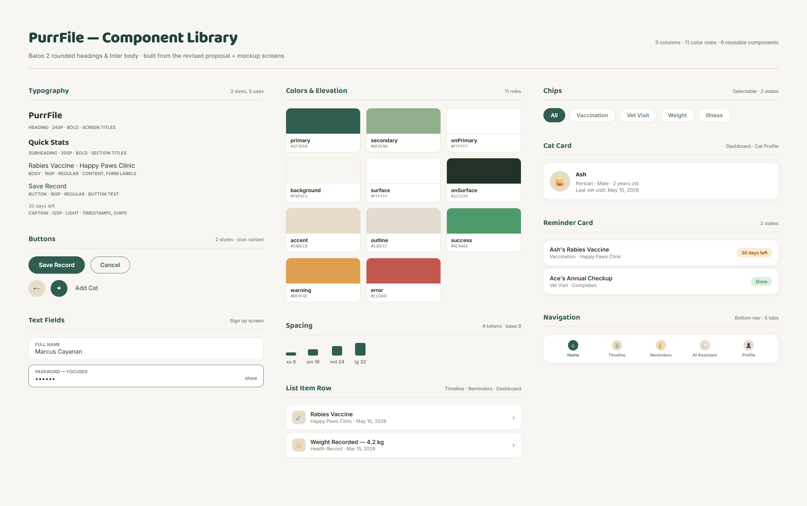

# Design system

Figma, Canva, Excalidraw, Google Slides or Docs exported to PDF all work. A
reader should be able to see your app's look in one glance, without reading a
table.

## Palette
Primary: #2F5D50 for buttons, active navigation, and important actions.

Secondary: #8FAF8A for icons, badges, and highlights.

Background: #F8F6F2 for the main screen background.

Surface: #FFFFFF for cards, list rows, and text fields.

Text: #1F2E27 for headings and body text.

Tertiary: #E8DCC8 for tabs, badges, and information banners.

Outline: #E3DCCF for card borders and input fields.

Error: #C1584F for errors and overdue reminders.

Theme: Light mode, with dark mode as a possible future improvement.

## Type scale
Heading: headlineSmall, 24sp, bold. Used for main screen titles.

Subheading: titleLarge, 20sp, bold. Used for section titles.

Body: bodyLarge, 16sp, regular. Used for record details, form labels, and AI responses.

Button: labelLarge, 16sp, medium. Used for button labels.

Caption: bodySmall, 12sp, regular. Used for dates, clinic names, and status labels.

Implementation: Uses Flutter's TextTheme for consistent typography.

## Spacing
Extra small (xs): 4px.

Small (sm): 8px.

Medium (md): 16px.

Large (lg): 24px.

Screen padding: 16px on the left and right sides.

List item gaps: 12–16px.

Section gaps: 24px.

Implementation: Uses reusable spacing constants through the AppSpacing class.

## Components

CatCard

File: lib/widgets/cat_card.dart

Parameters: Cat cat, VoidCallback onTap

Used on: Dashboard.

- HealthRecordTile

File: lib/widgets/health_record_tile.dart

Parameters: HealthRecord record, VoidCallback onTap

Used on: Health Timeline and Profile.

- ReminderTile

File: lib/widgets/reminder_tile.dart

Parameters: Reminder reminder, VoidCallback onTap

Used on: Reminders and Notifications.

- PrimaryButton

File: lib/widgets/primary_button.dart

Parameters: String label, VoidCallback? onPressed

Used on: Login, Health Timeline, Reminders, and Add/Edit Health Record.

- FilterChipBar

File: lib/widgets/filter_chip_bar.dart

Parameters: List<String> options, String selected, ValueChanged<String> onSelected

Used on: Health Timeline.

- StatusBadge

File: lib/widgets/status_badge.dart

Parameters: String label, BadgeStyle style

Used on: Reminder cards.

- ChatBubble

File: lib/widgets/chat_bubble.dart

Parameters: String message, bool isUser

Used on: AI Health Assistant.

- PurrBottomNav

File: lib/widgets/purr_bottom_nav.dart

Parameters: int currentIndex, ValueChanged<int> onTap

Used on: All main screens except Login.

## Changes since the last version
Palette: Expanded from five manually selected colors to a complete color scheme with 12 roles.

Contrast: Added contrast checks to improve text readability.

Typography: Replaced individual font sizes with reusable Flutter TextTheme styles.

Spacing: Organized spacing values into reusable constants.

Components: Defined eight reusable widgets with specific files, parameters, and screen locations.

Overall improvement: Made the design more consistent, organized, and easier to maintain.
